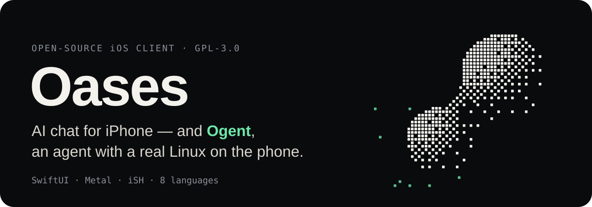
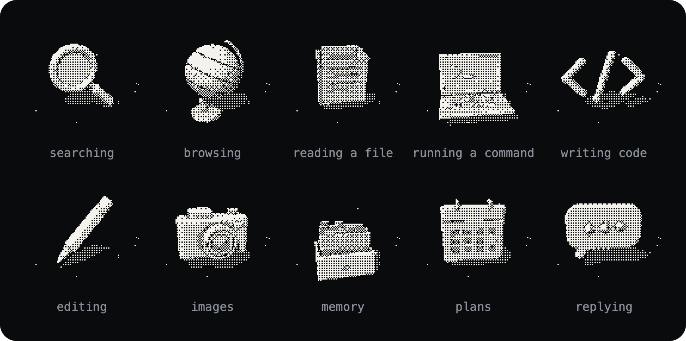
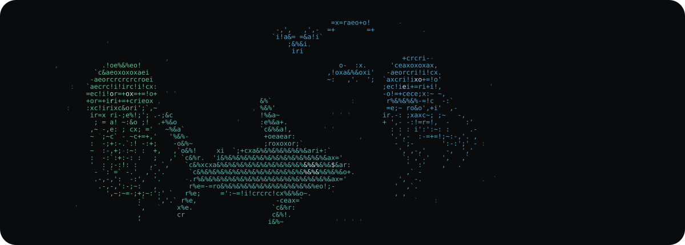

<p align="center">
  
</p>

<p align="center">
  <a href="#build">Build</a> ·
  <a href="#how-its-built">How it's built</a> ·
  <a href="#license">License</a> ·
  <a href="#中文说明">中文说明</a>
</p>

Oases Chat is an iPhone and iPad app for talking to AI models — in text, by voice and with images. Its engineering mode, **Ogent**, works the way an engineer works at a computer: it runs commands, reads and writes files and browses the web inside a real Linux system (Alpine, emulated by iSH) that lives in the app, on the device.

This repository is the complete source of the iOS client.

## Ogent thinks in pictures

<p align="center">
  
</p>

While it works, Ogent shows what kind of work it is doing as a small 3D object in 1-bit dithering — a magnifier while it searches, a laptop while a command runs, a speech bubble while it writes the answer. They are drawn live by a Metal shader in the app (`DitherMind.metal`), not image files; the board above is that shader's own output.

## What it does

- **Text** — chat with models; web search with sources; tools for calendar, reminders, contacts, photos, location, clipboard and memory.
- **Voice** — read replies aloud and dictate.
- **Images** — generate images, and edit them from a reference.
- **Meeting notes** — record on the device with live transcription, then notes and translation.
- **Ogent** — shell, files, a browser, skills, MCP servers, sub-agents and scheduled automations, all running on the phone.

<p align="center">
  
</p>

Behind Ogent lives an ASCII ocean: jellyfish, with a shark, a whale, dolphins, a manta ray, a sea turtle or a flock of gulls passing through in turn. It follows the agent — the colours shift while it thinks or calls a tool, and sending a message sends a ripple. The frame above is one step of the app's own simulation (`AsciiOceanSimulation.swift`), written out as text.

## How it's built

- **App** — SwiftUI, iOS 17+, Swift 5.10 with complete concurrency checking; the Xcode project is generated from `project.yml` by XcodeGen.
- **Ogent's computer** — [iSH](https://github.com/ish-app/ish) (its [ARM64 fork](https://github.com/OpenMinis/ish-arm64)) runs an Alpine Linux 3.21 root file system shipped in the app; native bridges let Linux programs reach iOS (clipboard, files, the browser).
- **Models** — any OpenAI-compatible chat API, plus Anthropic and Gemini adapters; people can add their own providers in the app.
- **Graphics** — Metal shaders for the thinking objects, the liquid-metal mark and the ocean.
- **Languages** — Simplified and Traditional Chinese, English, Japanese, Korean, French, German, Russian.

| Path | What's there |
| --- | --- |
| `OasesChat/Features` | Screens: chat, Ogent, meetings, settings, providers… |
| `OasesChat/Services` | Chat and agent loops, model providers, the Linux runtime |
| `OasesChat/DesignSystem` | Components and Metal shaders |
| `OasesChat/Resources` | The Alpine file system, built-in skills, licenses |
| `Extensions` | Widget, Share extension, File Provider |
| `vendor` | iSH (with its source in `vendor/iSH/source`) and Swift packages |

## Build

Requirements: Xcode 26 or later and [XcodeGen](https://github.com/yonaskolb/XcodeGen).

```sh
git clone https://github.com/qingtengCHINA/Oases.git && cd Oases
cp OasesChat/.env.example OasesChat/.env   # your endpoint and key
xcodegen generate
python3 scripts/strip_local_package_folder_refs.py
open OasesChat.xcodeproj
```

- Set your own team and bundle identifiers in `project.yml` (`DEVELOPMENT_TEAM`, `PRODUCT_BUNDLE_IDENTIFIER`) before signing.
- `OasesChat/.env` and the generated `OasesChat/Generated/Secrets.swift` are ignored by git; keys never belong in this repository.
- The Oases API service is separate and closed. It only accepts the official app (App Attest), so a build from source needs an OpenAI-compatible endpoint of your own, or providers added in the app under **Settings › Advanced › Manage Providers**.

## License

Oases Chat for iOS is free software under the [GNU General Public License, version 3](LICENSE). It is built on [iSH](https://github.com/ish-app/ish) and parts of its code are ported from [OpenMinis](https://github.com/OpenMinis/OpenMinis), both GPL-3.0.

- [`LICENSE.IOS`](LICENSE.IOS) — App Store distribution statement
- [`NOTICE.md`](NOTICE.md) — every third-party component and where its source is
- [`TRADEMARKS.md`](TRADEMARKS.md) — the Oases names and logo are not part of the license; forks need their own

## 中文说明

Oases Chat 是一款 iPhone / iPad 应用，可以用文字、语音和图片与 AI 模型对话。它的工程模式 **Ogent** 像工程师用电脑一样做事：在 App 内置的一套真正的 Linux 系统（Alpine，由 iSH 模拟）里运行命令、读写文件、浏览网页，全部在手机上完成。本仓库是 iOS 客户端的完整源代码。

- **文本**：与模型对话；联网搜索并标注来源；日历、提醒事项、通讯录、照片、定位、剪贴板、记忆等工具。
- **语音**：朗读回复、语音输入。
- **图像**：生成图片，也可以参考图片进行编辑。
- **会议纪要**：在设备上录音并实时转写，再生成纪要和翻译。
- **Ogent**：终端、文件、浏览器、技能、MCP 服务、子代理和定时自动化，都在手机上运行。

Ogent 工作时会用一个 1-bit 抖动画法的 3D 小物体表示正在做什么：搜索时是放大镜，运行命令时是笔记本电脑，写回复时是对话气泡。这些物体由 App 里的 Metal 着色器（`DitherMind.metal`）实时绘制，上面的图就是它的输出。Ogent 页面的背景是一片 ASCII 海洋：水母常驻，鲨鱼、鲸鱼、海豚、蝠鲼、海龟和海鸥轮流经过，颜色会随代理的状态变化。

**编译**：需要 Xcode 26 或更高版本和 XcodeGen。复制 `OasesChat/.env.example` 为 `OasesChat/.env` 并填写你自己的接口地址和 Key，然后运行上面「Build」一节的命令；签名前请在 `project.yml` 里换成你自己的团队和 Bundle ID。Oases API 是独立的闭源服务，只接受官方 App（App Attest 校验），自行编译的版本请使用你自己的 OpenAI 兼容接口，或在 App 的「设置 › 高级 › 管理供应商」里添加。

**许可**：GNU 通用公共许可证第 3 版（[`LICENSE`](LICENSE)）。本项目基于 [iSH](https://github.com/ish-app/ish)，部分代码移植自 [OpenMinis](https://github.com/OpenMinis/OpenMinis)，二者都以 GPL-3.0 发布。App Store 分发说明见 [`LICENSE.IOS`](LICENSE.IOS)，第三方组件见 [`NOTICE.md`](NOTICE.md)，名称与标志见 [`TRADEMARKS.md`](TRADEMARKS.md)。
